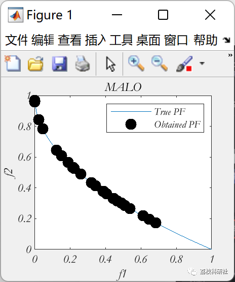

# Multi-Objective Ant Lion Optimization Algorithm (MOALO)

💥💥💥💞💞💞 Welcome to this blog❤️❤️❤️ 💥💥💥
🏆 Bloggers' Advantages: 🌞🌞🌞 The content of the blog strives for rigorous thinking and clear logic to facilitate readers.
⛳️ Mantra: A journey of a thousand miles begins with a single step.
Litchi Research Society
Code Collection: Power Systems, Intelligent Algorithms and Applications, Neural Network Prediction, Path Planning, Optimized Scheduling, Workshop Scheduling, Image Processing, Signal Processing...
🎁 Special Section Links:
🌈🌈🌈🌟🌟🌟 Electrical Code Intelligent Algorithms and Their Applications Path Planning Neural Network Prediction Optimized Scheduling Image Processing Workshop Scheduling Signal Processing Romantic Her Thoughts Math Modeling Complete Code Issues
💥1 Overview
Multi-objective Ant Lion Optimization Algorithm (MOALO). Firstly, a repository is used to store the non-dominant Pareto optimal solutions obtained so far. Then, a wheel mechanism is used to select solutions from the repository based on the solution as the coverage range of the ant lion, guiding the ant into promising areas in the multi-objective search space.
📚2 Running Results
🎉3 References
[1] Mirjalili, Seyedali, Pradeep Jangir, and Shahrzad Saremi. 
Multi-objective ant lion optimizer: a multi-objective optimization algorithm for solving engineering problems. Applied Intelligence 
(2016): 1-17, DOI: http://dx.doi.org/10.1007/s10489-016-0825-8
🌈4 MATLAB Code Implementation
Click the article below left [Read Full Content]

## Images

<!-- PAYMENT_BLOCK -->

## Get this dataset

- Payment link (Stripe): [Buy now](https://buy.stripe.com/3cs8yP7sY87d0vu9AB)
- Payment QR code: 

<!-- /PAYMENT_BLOCK -->
